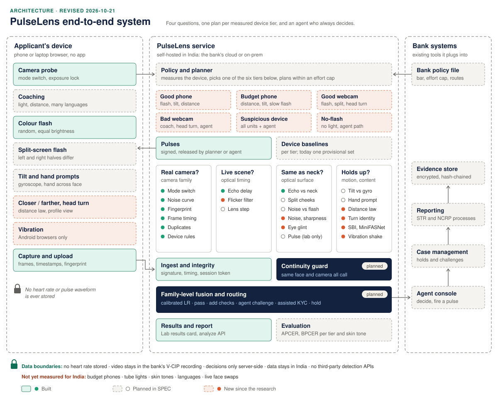

# PulseLens

Camera-first liveness for Indian video-KYC (RBI V-CIP). A 48-hour prototype for the Amazon AI Cyber Security Hackathon finale, Challenge 03, team Mama Mia (Thapar): Ganeev Singh Tuteja, Yash Vishnoi, Keshav Juneja.

> **Status: prototype, PROVISIONAL THRESHOLDS.** Every number below was measured on about 7 genuine sessions from one person on one laptop webcam, plus a replay and a fake camera. There are no live face-swap recordings yet. Read the claims as hypotheses until the experiments at the end are done.

## The idea

A live deepfake (Deep-Live-Cam, DeepFaceLive) does not make a fake video. It takes the attacker's real camera frame and **repaints one patch of it**: the face, regenerated from a small crop every frame and blended back in. The neck, hair, background, sensor noise and the light from our screen all stay real.

So PulseLens does not ask "is this AI?". It asks four physical questions:

1. **Is it a real camera?** Virtual cameras, emulators and injected streams behave differently from a sensor.
2. **Is the scene live?** We flash random colours on the customer's screen; a recording cannot answer them.
3. **Is the face the same physical surface as the skin around it?** The repainted patch should differ from the real neck in how it reflects our light, in its noise and sharpness, and in 3-D shading.
4. **Does the face hold up under stress?** Head turns, vibration and prebuilt detectors look for the seams of the repaint.

A person (the V-CIP agent) always makes the final call. PulseLens never auto-rejects a customer; a check that cannot judge a weak device abstains and adds an agent question instead.

## Architecture



| Question | Catches | Built | Not built yet |
|---|---|---|---|
| Real camera? | OBS and other virtual cameras, Android emulators, injected streams (CEN/TS 18099 injection attacks) | Mode-switch probe, noise curve, sensor fingerprint (PRNU, PCE), frame timing, duplicate frames, claim/env/label rules | — |
| Live scene? | Screen replays, pre-rendered fakes | Random colour flash with an echo-delay check; exposure lock on slow cameras | 50 Hz tube-light flicker filter |
| Same as the neck? | Live face swaps | Face-vs-neck flash echo (strength, with safe abstaining) | Split-screen flash (two cheeks lit differently), face-vs-neck noise and sharpness, screen glint in the eye, pulse agreement (Lab only) |
| Holds up? | Live face swaps, masks | — | SBI blending-seam detector, MiniFASNet anti-spoofing, identity through a profile turn, phone vibration (Android), hand over the face, continuity lock |
| Decide | — | Provisional thresholds (`server/pulselens/calibration/bootstrap.yaml`), Lab results card | Planner per device, calibrated logistic-regression fusion, agent console, routing to the five outcomes |

**Why not measure heart rate?** A live swap copies the attacker's own pulse onto the fake face (median r = 0.89 for DeepFaceLive, Fraunhofer HHI 2025), and the attacker's neck and hand are real, so pulses at every site agree. Reading a pulse also needs at least 20 fps and 10–20 s, more than many budget cameras give. Our flash does the same job better: it is a pulse we control, much stronger, with a known timing. Pulse agreement stays a Lab measurement. PulseLens never stores a heart rate or a pulse waveform.

**Why prebuilt detectors only as features?** Detectors like SBI are trained on offline, compressed fakes, and their accuracy drops on unseen data (cross-dataset AUC around 0.72–0.89 in reproductions), and further on Indian webcams and faces. They also tend to fail together. They enter as one family, scored against genuine sessions and weighted by fusion, never as the only vote. No faces are sent to third-party APIs.

## What changed from the original idea

The original pitch (final deck v6) was "Deepfakes fool faces. PulseLens checks the camera": three questions (real camera, live physics, same camera all call), with **the face lagging the neck** as the star test. The research and our recordings kept the frame but moved where the strength against live swaps comes from. Full reasoning: [`docs/research/deck_review.md`](docs/research/deck_review.md).

| | Original idea | What changed | Why it is better |
|---|---|---|---|
| Core claim against live swaps | The face lags the neck when the screen flashes | The face is a repainted patch of a real frame; test whether it reflects light, shows noise and shades in 3-D like the real neck | Live swaps may copy our flash in the same frame, with no lag; a repaint can't easily fake 3-D shading or sensor noise |
| Structure | 3 questions | 4 questions: real camera, live scene, same surface as the neck, holds up under stress | Each targets a different attack, so fusing them across families means something |
| Face-vs-neck check | Timing (lag) | Echo strength (built), colour direction (planned), safe abstaining | One webcam frame (64–96 ms) is longer than the lag limit, so timing falsely failed genuine users |
| Split-screen flash | One of three echoes | The main optical test against live swaps | The one optical test a colour transfer can't fake (Face Flashing, Gerstner & Farid) |
| Heart rate, multi-site pulse | Stretch goal; "noise follows pulse" | Lab-only measurement; the flash replaces it ("a pulse we control") | A live swap copies the attacker's real pulse (r = 0.89); our cameras are too slow to read one |
| Prebuilt AI models | Not in the plan | SBI and MiniFASNet scored as one family | They cover blending seams physics can't see, without being the sole judge |
| Challenges | Tilt and hand occlusion | Profile turn with identity tracking and Android vibration added; hand occlusion demoted | Pose challenges scored best in the live-swap study; masks now defeat hand occlusion |
| Eye reflection | — | Screen glint in the cornea (idea) | A swap regenerates the eyes, so the reflection should be lost or wrong |
| Sensor fingerprint | "Missing in generated video" | Supporting evidence only, limit 50 | Chromium's fake camera produced a stable fingerprint (PCE 97) |
| Camera checks | Planned | Built: mode probe, noise curve, fingerprint, timing, duplicates, rules, plus an exposure lock | They catch the fake camera, pass the real one, and line up with CEN/TS 18099 |
| Decisions | Rules with per-device thresholds | Thresholds learned from genuine sessions only, then logistic-regression fusion, with error rates per device and skin tone | Fits our data size: few attack samples, and two-class models generalise badly to unseen attacks |
| India claims | "Built for real Indian phones" | A measured-vs-assumed list: budget phones, tube lights, skin tones, languages and live swaps are all untested | Honest, and it gives a concrete test plan |
| Prior work | Novelty table missing the two closest papers | Gerstner & Farid 2022 and An et al. 2024 cited, with what is different | Keeps "we didn't find, not first" credible |

**Unchanged, because the research backs it:** camera first, random active light against replays, never auto-reject, abstain on weak devices, the agent in the loop, hold only when two families flag, the continuity lock, no pulse stored.

**Still to prove:** none of the new swap-specific tests has been run against a real live swap yet. Whether the new idea beats the old one depends on recording Deep-Live-Cam sessions first.

## Built for India, and what is not measured yet

| Indian reality | How the design handles it | Status |
|---|---|---|
| RBI V-CIP: live, agent-led, liveness, data in India | The agent always decides; self-hosted server; no third-party APIs | Principle built; agent console not built |
| DPDP Act: data minimisation, consent | No heart rate or pulse waveform stored; pseudonymous person codes | Built |
| About 95% Android, mostly budget phones | Phones get a full-screen flash and vibration; desktops get camera checks and a border flash | **No phone tested yet** |
| Dim rooms drop cameras to 10–15 fps | Light checks abstain below 12 fps and route to an agent challenge | Built; abstain rate on phones unknown |
| Wide range of skin tones | Face is compared with the neck of the same person, no absolute colour thresholds | **Not measured**; error rates must be reported per skin tone (Monk scale) |
| Tube lights flicker at 50 Hz | — | Gap: flicker filter needed |
| Patchy 4G uploads | Frames uploaded as JPEG | Bandwidth not measured |
| Many languages, low literacy | Icon-first coaching steps | Not built |
| Elderly users helped by family (two faces in frame) | An Assisted KYC outcome | Not built in code |

**Adaptable by design**
- **New check, no rewrite.** Each check is a module registered in `server/pulselens/planner/registry.py`; adding SBI or the split flash adds a file.
- **Thresholds are configuration.** They live in `bootstrap.yaml` and will be recalibrated per device class on a bank's own genuine sessions (M2.6, planned).
- **The plan adapts to the device.** A planner picks checks by capability: vibration on Android, full-screen flash on phones, camera checks everywhere (planned).
- **Fusion is retrainable and inspectable.** Logistic-regression weights per deployment, reported as APCER and BPCER (ISO/IEC 30107-3) per attack tool, device and skin tone (planned).

## What we have measured

- **Fake camera (Chromium):** accepted an unusual 1000×750 mode and switched in 57–105 ms with no dropped frames. The real webcam refused that mode and passed every camera check.
- **Replay of a genuine session:** every camera check passed it (fingerprint PCE 7542); the light echo answered 0 of 6 flashes and failed. This is exactly why active light is needed.
- **Laptop webcam, bright room:** 15.6 fps, face echo near the noise floor. **Dim room:** echo 3–6× stronger but the camera fell to 10.4 fps, below the 12 fps floor, so the light checks abstained. An exposure lock (when fps < 27, 33 ms exposure) was added and is not yet confirmed on re-recordings.
- **Sensor fingerprint:** genuine sessions as low as PCE 174; Chromium's fake camera produced a stable pattern at PCE 97. The fingerprint is supporting evidence, not proof of a sensor; the limit is 50.
- **Tests:** 444 pytest passed (1 skipped), 131 web tests, lint clean, e2e in headed Brave.

Details and every threshold decision: `docs/STATUS.md`. Research:
- [`docs/research/pulse_and_illumination.md`](docs/research/pulse_and_illumination.md): multi-site pulse, screen illumination, rules vs learning
- [`docs/research/live_swaps_and_detectors.md`](docs/research/live_swaps_and_detectors.md): what a live swap can't fake, prebuilt detectors, active probes, ranked ideas
- [`docs/research/deck_review.md`](docs/research/deck_review.md): the final deck and doc checked against the research and our measurements

## Next experiments, in order

1. **Record live-swap sessions** with Deep-Live-Cam on a consenting teammate, using the tool as-is through the Lab Record page (a human does this; the repo never contains attack tooling).
2. **Face vs neck noise and sharpness**, offline, on existing and new sessions.
3. **SBI, MiniFASNet and identity through a head turn**, scored as features.
4. **Split-screen flash** in capture and a check for it.
5. **Indian conditions:** 2–3 budget Android phones, a tube-light room, volunteers across skin tones.
6. **Calibration and fusion**, evaluated person-disjoint, with APCER and BPCER per device and skin tone.

## Run it

Needs Python 3.11, Node 22.12+, and `make` (or `python scripts/dev.py <target>` without it).

```bash
make setup       # venv, npm ci, .env from .env.example, model files
make server      # API on :8000
make lab         # Lab site on :5173
make demo        # Demo site on :5174
make tunnel      # HTTPS tunnels for testing on phones
make test        # pytest
make test-web    # tsc + vitest
make e2e-brave   # Playwright in the installed Brave, headed
make lint
python -m pulselens.cli analyze data/sessions/<id> --plots
```

## Repo map

| Path | What |
|---|---|
| `apps/lab` | Experiments site: device details, Record, results |
| `apps/demo` | Judges' site: customer view and presenter view |
| `packages/capture` | Framework-free browser capture: probe, exposure lock, flashes, frame upload |
| `packages/explain`, `packages/types`, `packages/ui` | On-screen explanations, generated types, shared components |
| `server/pulselens/checks` | One module per check |
| `server/pulselens/vision` | Noise, PRNU, face regions, frame tools |
| `server/pulselens/api` | FastAPI REST and WebSocket |
| `docs` | `SPEC.md`, `BUILD_PLAN.md`, `STATUS.md`, `EXPLAINERS.md`, research notes |

## Privacy and ethics

- No heart rate, pulse waveform, secrets or volunteer data in git; session data lives in the gitignored `data/`.
- Tests use synthetic fixtures only, with no real faces.
- The code detects; it never generates, improves or disguises deepfakes. Attack sessions are recorded by a person with existing tools, only on consenting teammates.

## Sources

Gerstner & Farid, CVPR-W 2022 (active illumination against real-time deepfakes); An et al., IET Biometrics 2024 (face-vs-neck rPPG); Seibold et al., Frontiers in Imaging 2025 (deepfakes inherit the driver's pulse); Tang et al., NDSS 2018 (Face Flashing); Shiohara & Yamasaki, CVPR 2022 (SBI); "Not All Challenges Are Equal", arXiv 2610.16417; corneal reflection probing, arXiv 2210.14153; SFake, arXiv 2409.10889; CEN/TS 18099:2024; ISO/IEC 30107-3. Full lists with links in the research notes above.
